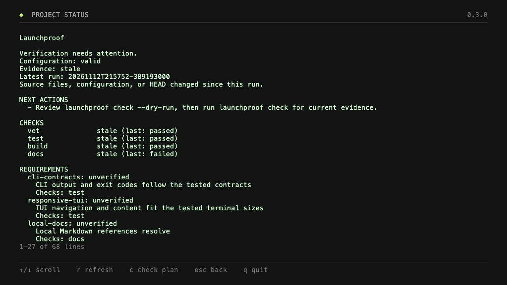

# Launchproof

**Know what's ready. Know what's next.**

A local CLI workspace for turning a project idea into specs, real checks, and a useful handoff. Built with Go, Cobra, and Charm. MIT licensed.

[](https://github.com/kanuwrld/launchproof/actions/workflows/ci.yml)


## What it does

- **Status** shows changed files, current or stale evidence, acceptance mappings, and the next action without executing checks.
- **Inspect** the actual stack, package manager, scripts, documents, and Git state.
- **Initialize** SPEC.md, TASKS.md, AGENTS.md, and an explicit check configuration from four project questions.
- **Diagnose** missing runtimes, dependencies, configuration, and setup documents.
- **Check** configured commands with live status, bounded logs, timeouts, and cancellation.
- **Report** real exit codes, timing, logs, and source fingerprints; mark old evidence stale after source changes.
- **Handoff** project facts, decisions, tasks, changed paths, and actual verification for the next session.
- **Read and validate docs**, browse project folders, and reopen recent projects in a responsive TUI.

Inspection, doctor, and documentation validation do not execute project scripts. **Only an explicit check runs commands** from `launchproof.json`. Use checks in projects you trust. Launchproof does not call an LLM or certify production readiness.

## Install

### Download a binary — no Go required

Open the [v0.3.0 release](https://github.com/kanuwrld/launchproof/releases/tag/v0.3.0), download the archive for your operating system and CPU, and extract it.

| Computer | Archive suffix |
| --- | --- |
| macOS, Apple Silicon | `darwin_arm64.tar.gz` |
| macOS, Intel | `darwin_amd64.tar.gz` |
| Linux, x86-64 | `linux_amd64.tar.gz` |
| Linux, ARM64 | `linux_arm64.tar.gz` |
| Windows, x86-64 | `windows_amd64.zip` |
| Windows, ARM64 | `windows_arm64.zip` |

From the extracted directory, run `./launchproof` on macOS/Linux or `.\launchproof.exe` in PowerShell. Pass a project path to open another directory. Add the executable directory to your `PATH` to use the commands below from anywhere.

Git is optional. Running a project's checks still requires that project's runtime and installed dependencies. Archives include documentation and its local images; SHA-256 checksums accompany the release.

### Build from source

Requires **Go 1.26.7 or newer** and Git.

macOS / Linux:

```sh
git clone https://github.com/kanuwrld/launchproof.git
cd launchproof
go build -o bin/launchproof ./cmd/launchproof
./bin/launchproof
```

Windows PowerShell:

```powershell
git clone https://github.com/kanuwrld/launchproof.git
cd launchproof
go build -o bin/launchproof.exe ./cmd/launchproof
.\bin\launchproof.exe
```

On macOS, `Launchproof.command` also builds the CLI if needed and opens it in Terminal.

### Install with Go

```sh
go install github.com/kanuwrld/launchproof/cmd/launchproof@v0.3.0
```

Go puts the executable in `GOBIN`, or in the `bin` directory under `go env GOPATH` when `GOBIN` is unset. Add that directory to your shell's `PATH`.

## Use it

These examples assume `launchproof` is on your `PATH`. From a source checkout, use `./bin/launchproof` on macOS/Linux or `.\bin\launchproof.exe` in PowerShell instead.

```sh
launchproof                           # responsive interactive workspace
launchproof /path/to/project           # open another project
launchproof status                    # changes, evidence gaps, next actions; read-only
launchproof status --strict --json     # nonzero when configured verification is incomplete
launchproof inspect --json             # read-only discovery, one JSON document
launchproof doctor                    # diagnose setup; never runs project scripts
launchproof init                      # four questions; preserve existing files
launchproof check --dry-run            # preview commands
launchproof check                     # execute configured checks
launchproof report                    # latest results with current/stale status
launchproof report --output .launchproof/REPORT.md
launchproof handoff                    # print and save .launchproof/HANDOFF.md
launchproof docs check                # local links, anchors, script references
launchproof view README.md             # read Markdown as plain text
launchproof projects                   # recently opened folders
launchproof --no-motion
launchproof --plain
launchproof --help
launchproof completion zsh
```

For a typical existing project: **status → doctor → init → review the config → check → status → handoff**. Initialization uses your answers and detected commands; missing requirements remain explicitly undecided. An acceptance answer becomes an unmapped requirement: link it to checks that actually exercise it. Existing specs and instructions are preserved. Existing `.gitignore` gains an entry for private run state.

Non-interactive setup:

```sh
launchproof init --defaults --goal "A booking app" \
  --audience "Local customers" \
  --acceptance "A customer can create and cancel a booking" \
  --constraints "Keep the existing database"
launchproof check --only test,docs --json
launchproof report --json
```

`status`, `doctor`, `init`, `check`, `report`, `docs check`, and `projects` support `--json`. `--json` emits one document on stdout; errors go to stderr. Failed, cancelled, timed-out, or stale check runs exit nonzero. Skips remain visible and do not count as passing checks. A run with no passing checks exits nonzero. `report` displays evidence; use `status --strict` for a complete-scope exit check.

## Daily status

```sh
launchproof status
launchproof check --dry-run
launchproof check
launchproof status --strict
```

`status` reads the selected project's Git changes and latest saved run. It reports staged, unstaged, and untracked paths, excludes managed state and configured exclusions, and hides sensitive filenames. It works without Git; no Git worktree means changes cannot be listed, not that verification failed. Renames appear as deletion/addition. The path list is limited to 200 entries with an omitted count.

The normal command exits successfully when it can produce a status, including missing configuration or evidence. `--strict` exits nonzero unless **all configured checks** have current passing results and **every declared requirement** is linked to passing checks. A run made with `check --only` keeps other checks skipped, so it cannot silently pass the strict gate. Evidence comes from the latest run only; older runs are not merged into a green result.

When no requirements are declared, the gate covers checks only and the output states that no acceptance mapping exists. `evidenced` means linked checks passed; it does not establish that the mapping is sufficient or the feature is complete. Changes to source, configuration, or HEAD make evidence stale. Dependencies, environment values, and external services remain outside the fingerprint.

In the TUI, press **s** from home. Use **r** to refresh and **c** to open the command plan; only Enter on that plan starts execution.



Example after editing source: previous results are stale until the checks run again.

## Check configuration

`init` detects root-level Node.js and Go projects. It proposes existing package scripts or Go vet/test/build commands and a built-in documentation check. Missing scripts become explicit skips. Review and edit `launchproof.json` before executing it.

```json
{
  "schema_version": 1,
  "project": {
    "goal": "Ship a useful CLI",
    "audience": "Developers",
    "acceptance": "Commands work in terminals and CI",
    "constraints": "Keep data local"
  },
  "checks": [
    {"id": "vet", "command": ["go", "vet", "./..."], "timeout_seconds": 120},
    {"id": "test", "command": ["go", "test", "./..."], "timeout_seconds": 120},
    {"id": "docs", "builtin": "docs"},
    {"id": "manual", "skip_reason": "Record the manual acceptance review separately."}
  ],
  "requirements": [
    {"id": "cli-contract", "description": "CLI input, output, and exit codes match the tested contract", "checks": ["test"]},
    {"id": "documentation", "description": "Local documentation links and script references resolve", "checks": ["docs"]},
    {"id": "manual-acceptance", "description": "Review the complete user workflow", "checks": []}
  ],
  "exclude": ["coverage", "dist"]
}
```

Commands are argument arrays, run sequentially from the project directory. There is no implicit shell expansion. Each check must specify exactly one of `command`, `builtin`, or `skip_reason`; IDs must be unique. The default timeout is 120 seconds; the maximum is one hour. At most 24 checks are accepted. Use explicit commands for monorepo or watch-mode test runners.

`requirements` is optional. Each entry has a unique ID, a description, and check IDs from this configuration. An empty `checks` list stays **unmapped** and blocks `status --strict`; skipped checks also block it. The example intentionally leaves manual acceptance unresolved. Do not link a requirement to an unrelated passing check just to make the status green. Up to 100 requirements are supported. Existing version-1 configurations without requirements still work; older Launchproof versions reject the new optional field.

Checks receive `CI=1`, `NO_COLOR=1`, and `TERM=dumb`. On Windows, package-manager `.cmd` wrappers are supported; unsafe shell metacharacters in their arguments are rejected. Native executable arguments are passed directly. Commands have your normal local permissions and can modify files or use the network; Launchproof is not a sandbox.

## Interactive controls

Choose **Project workspace**, or press **w**, to access checks, doctor, setup, documents, exports, handoffs, and the folder picker. The command plan is displayed before Enter starts execution. Select a running check and press Enter to watch its log.

| Key | Action |
| --- | --- |
| ↑ / ↓, j / k | Select items or scroll text |
| Enter | Open an item; start reviewed checks; continue setup |
| w / c / d / n / m / p / h | From home: workspace / checks / doctor / init / docs / projects / handoff |
| s | From home: project status |
| r / c | In status: refresh / open check plan |
| i / ? | From home: inspect / guide |
| x | Cancel a running check and remaining checks |
| r / e | On checks: rerun / export report |
| v | In documents: validate documentation |
| ~ | In folder picker: browse the home directory |
| Page Up / Down, Home / End | Navigate long text; Home / End select first/last list item |
| Esc | Back |
| q, Ctrl+C | Quit; during checks, cancel and save evidence first |

During setup, printable keys (including q) enter text; use **Ctrl+C** to quit. Questions and the review fit the same scrollable frame. Recent projects are stored in the OS user configuration directory; set `LAUNCHPROOF_HOME` to choose another location.

## Responsive layout

The header stays at the top and the footer stays at the bottom. The middle area uses the remaining height.

- Wide windows show branding and actions in columns; square and portrait windows stack them.
- Short windows shrink decorative content first. Lists and documents scroll inside the frame.
- Live resizing preserves the selected action and clamps scrolling to the available space.
- Layout uses terminal columns and rows. Below **24 columns × 10 rows**, a resize hint appears.

| 1:1 window | Portrait window |
| --- | --- |
|  |  |

See the [7:6 layout](assets/welcome-7-6.png), [short layout](assets/welcome-short.png), [inspection screen](assets/inspect.png), [workspace](assets/workspace.png), [check results](assets/checks.png), and [recorded demo](assets/demo.gif).

When stdin or stdout is not a terminal, in CI, with `TERM=dumb`, or with `ACCESSIBLE=1`, the welcome uses plain text. `NO_COLOR=1` disables colors. Animation stops after the greeting; `--no-motion` disables it entirely.

## Evidence, privacy, and limits

Run history lives in `.launchproof/runs/`; `latest.json` identifies the newest result. Reports recalculate freshness against current files and HEAD. Exporting inside `.launchproof/` does not invalidate evidence. Writing elsewhere may create a source change; existing files outside managed state are never overwritten by `report`.

- Fingerprints cover Git-tracked and non-ignored source files, or a directory walk when Git does not track the selected project directory, plus the configuration. `.launchproof/` and configured exclusions are omitted. Limits: 25,000 files, 256 MiB, 30 seconds.
- Private file contents are not read for fingerprinting; only their size and modification time are used. Dependency installations, environment values, external symlink targets, and external services are outside this evidence.
- Logs retain the last 64 KiB per command. Known secret-like environment values and common token formats are redacted; **review exports before sharing**, because arbitrary secrets cannot be reliably detected.
- `handoff` includes detected facts, config answers, changed file paths, DECISIONS.md and TASKS.md when present, and the latest results. Project-authored Markdown is treated as context, never executed.
- `docs check` parses Markdown links and images, local HTML `href`/`src`, heading anchors, and explicit `npm/pnpm/yarn/bun run <script>` references against root `package.json`. It checks up to 500 Markdown files, 2 MiB each. External URLs, arbitrary shell commands, and runtime correctness are not checked.
- For monorepos, select the relevant application directory. Missing manifests mean unsupported metadata, not a failed build. Symlinked manifests and outputs escaping the project are rejected.
- `inspect --json` retains `schema_version: 1` and `checks_executed: false`. Its success means discovery completed, not release approval.

## Development

```sh
make build
make check
make demo        # optional: VHS, ttyd, ffmpeg, and a Chromium-compatible browser
```

`make check` verifies formatting, runs `go vet`, and executes `go test -race`. CI covers Linux, macOS, and Windows. Tests include real subprocess failures, log limits/redaction, cancellation, timeouts, freshness, preserved docs, safe output paths, Markdown validation, JSON contracts, TUI navigation, resize, and pinned footers.

See [CONTRIBUTING.md](CONTRIBUTING.md) and [CHANGELOG.md](CHANGELOG.md).

## License

[MIT](LICENSE). Built on [Cobra](https://github.com/spf13/cobra), [Bubble Tea](https://github.com/charmbracelet/bubbletea), [Lip Gloss](https://github.com/charmbracelet/lipgloss), [Fang](https://github.com/charmbracelet/fang), and [Goldmark](https://github.com/yuin/goldmark).
