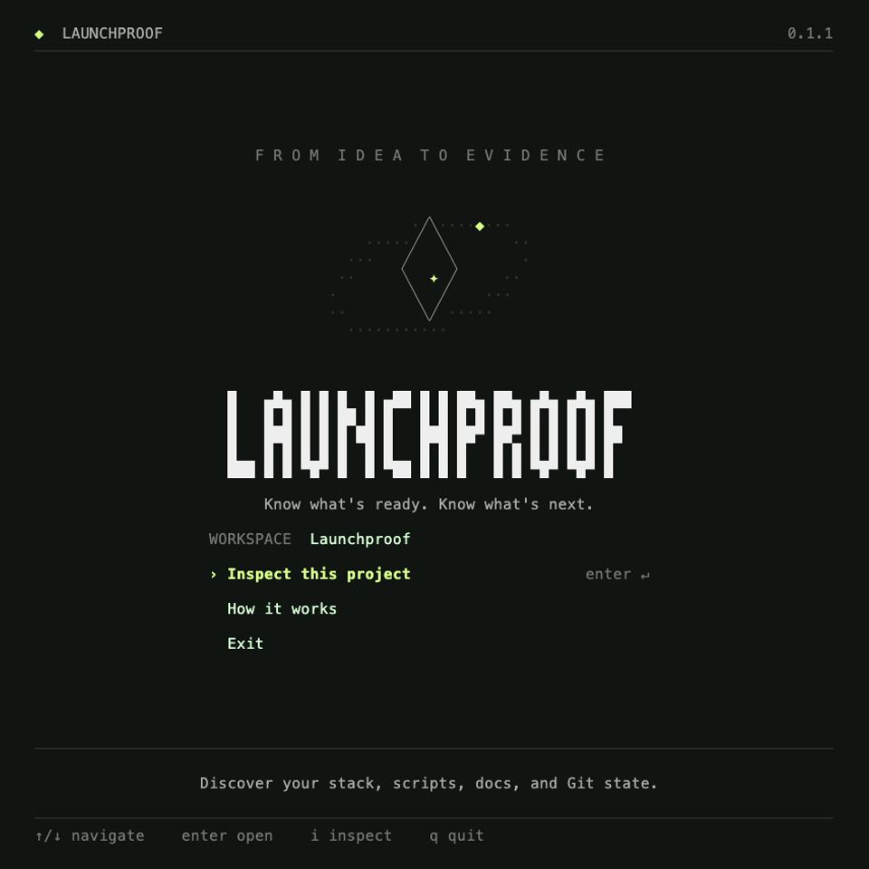
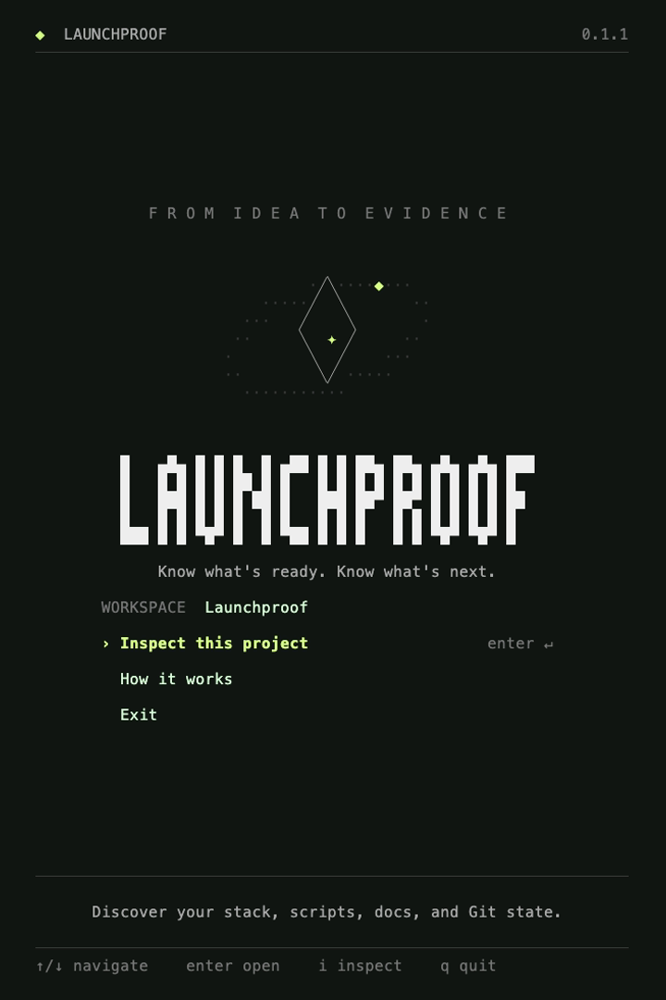

# Launchproof

**Know what's ready. Know what's next.**

A local-first CLI for inspecting your project before its next release. Built with Go, Cobra, and Charm. MIT licensed.

[](https://github.com/kanuwrld/launchproof/actions/workflows/ci.yml)


## What it does

- An animated, keyboard-driven welcome that reflows when you resize the terminal.
- Read-only inspection of Node.js, Next.js, React, TypeScript, and Go manifests.
- Package-manager detection, script names, project-document presence, and Git state.
- JSON for scripts and agents; plain, no-color, and reduced-motion modes.

Inspection **does not run your tests or project scripts**, read environment values, call an LLM, or certify release readiness. A discovered script is not a passing check.

## Install

### Download a binary — no Go required

Open the [v0.1.1 release](https://github.com/kanuwrld/launchproof/releases/tag/v0.1.1), download the archive for your operating system and CPU, and extract it.

| Computer | Archive suffix |
| --- | --- |
| macOS, Apple Silicon | `darwin_arm64.tar.gz` |
| macOS, Intel | `darwin_amd64.tar.gz` |
| Linux, x86-64 | `linux_amd64.tar.gz` |
| Linux, ARM64 | `linux_arm64.tar.gz` |
| Windows, x86-64 | `windows_amd64.zip` |
| Windows, ARM64 | `windows_arm64.zip` |

From the extracted directory, run `./launchproof` on macOS/Linux or `.\launchproof.exe` in PowerShell. Pass a project path to inspect a different directory. Git is optional; without it, inspection omits Git metadata.

### Build from source

Requires **Go 1.26.7 or newer** and Git.

macOS / Linux:

```sh
git clone https://github.com/kanuwrld/launchproof.git
cd launchproof
go build -o bin/launchproof ./cmd/launchproof
./bin/launchproof
```

Windows PowerShell:

```powershell
git clone https://github.com/kanuwrld/launchproof.git
cd launchproof
go build -o bin/launchproof.exe ./cmd/launchproof
.\bin\launchproof.exe
```

On macOS, `Launchproof.command` also builds the CLI if needed and opens it in Terminal.

### Install with Go

```sh
go install github.com/kanuwrld/launchproof/cmd/launchproof@v0.1.1
```

Go puts the executable in `GOBIN`, or in the `bin` directory under `go env GOPATH` when `GOBIN` is unset. Add that directory to your shell's `PATH` to use `launchproof` from anywhere.

## Use it

The examples below assume `launchproof` is on your `PATH`. If you built from source, use `./bin/launchproof` on macOS/Linux or `.\bin\launchproof.exe` in PowerShell instead.

```sh
launchproof                         # welcome for the current directory
launchproof /path/to/project         # welcome for another project
launchproof inspect                 # read-only inspection
launchproof inspect ./web --json     # one JSON document on stdout
launchproof --no-motion              # static greeting
launchproof --plain                  # text-only welcome
launchproof --help
launchproof completion zsh
```

| Key | Action |
| --- | --- |
| ↑ / ↓, j / k | Select a menu item; scroll a report or guide |
| Enter | Open the selected item |
| i | Inspect the project |
| ? | Open the guide |
| r | Refresh inspection |
| Page Up / Down, Home / End | Navigate long reports and the guide |
| Esc | Return to the welcome |
| q, Ctrl+C | Exit |

## Responsive layout

The header stays at the top and the footer stays at the bottom on every page. The middle area uses the remaining height.

- **Wide windows:** branding and project actions sit in two columns.
- **Square and portrait windows:** the artwork, wordmark, and menu stack vertically.
- **Short windows:** decorative content shrinks first, keeping every menu action visible.
- **Long reports, errors, and guides:** content scrolls inside the middle area; the footer does not move.
- **Live resizing:** layout changes preserve the selected action and clamp the scroll position to the new viewport.

Layouts depend on available terminal columns and rows, rather than a fixed pixel aspect ratio. Terminal fonts have different cell proportions. The menu needs at least **24 columns × 10 rows**; smaller windows show a resize hint and the quit key.

| 1:1 window | Portrait window |
| --- | --- |
|  |  |

Also see the [7:6 layout](assets/welcome-7-6.png), [short layout](assets/welcome-short.png), [inspection screen](assets/inspect.png), and [recorded demo](assets/demo.gif).

When stdin or stdout is not a terminal, in CI, with `TERM=dumb`, or with `ACCESSIBLE=1`, the welcome uses plain text. `NO_COLOR=1` disables colors. Animation stops after the greeting; `--no-motion` disables it entirely.

## Inspection boundaries

The inspector reads root-level `package.json` and `go.mod`, checks known lockfiles and documents, and asks Git for metadata. For a monorepo, pass the application directory explicitly.

- Manifest reads are limited to 2 MiB. Symlinked manifests are rejected.
- Script **names** are exported; script bodies and `.env` contents are not.
- Conflicting lockfiles produce notes; a declared `packageManager` takes precedence.
- Missing manifests mean unsupported metadata, not a failed build.
- No shell commands are taken from project files. Git filesystem-monitor hooks are disabled.
- Terminal control sequences are removed from repository-provided display text.

`inspect --json` uses `schema_version: 1` and includes `checks_executed: false`. Exit status 0 means inspection completed, not that a release is approved. Invalid paths and malformed manifests exit nonzero.

## Development

```sh
make build
make check
make demo        # optional: VHS, ttyd, ffmpeg, and a Chromium-compatible browser
```

`make check` runs formatting checks, `go vet`, and `go test -race`. Without Make, run the Go commands directly. `make demo` regenerates the recording and responsive screenshots.

Tests cover manifests, no-execution/no-secret-output boundaries, Git state, JSON, navigation, live resize transitions, pinned footers, and scrolling. CI verifies Linux, macOS, and Windows.

See [CONTRIBUTING.md](CONTRIBUTING.md) and [CHANGELOG.md](CHANGELOG.md).

## Direction

Next: explicit check configuration and a runner that records commands, exit codes, source fingerprints, and reports. After that: Markdown reports and links between requirements and checks. These features are planned, not included in the current CLI.

## License

[MIT](LICENSE). Built on [Cobra](https://github.com/spf13/cobra), [Bubble Tea](https://github.com/charmbracelet/bubbletea), [Lip Gloss](https://github.com/charmbracelet/lipgloss), and [Fang](https://github.com/charmbracelet/fang).
