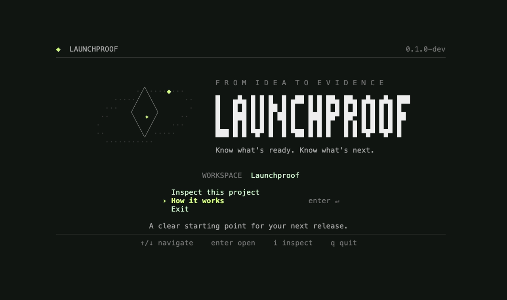

# Launchproof

**Know what's ready. Know what's next.**

A local-first CLI for a clearer path from a repository to a release. Built with Go, Cobra, and Charm.



## Available today

- An animated welcome screen with keyboard navigation.
- A read-only project inspector for Node.js, Next.js, React, TypeScript, and Go manifests.
- Package-manager detection, script discovery, project-document presence, and Git state.
- JSON output for scripts and agents.
- Compact terminal layouts, plain output, no-color, and reduced-motion modes.

This first version **inspects metadata**. It does not run tests, execute project scripts, read environment values, call an LLM, or certify that an application is ready to ship. Script discovery is not a passing test result.

## Install from source

Requires Go 1.26.7 or newer. Git is optional for inspection, and required to clone this repository.

```bash
git clone https://github.com/kanuwrld/launchproof.git
cd launchproof
go build -o bin/launchproof ./cmd/launchproof
./bin/launchproof
```

Or install the CLI into your Go binary directory:

```bash
go install github.com/kanuwrld/launchproof/cmd/launchproof@latest
```

Add that directory to your PATH if needed.

## Use it

```bash
launchproof                         # welcome screen for the current directory
launchproof /path/to/project         # welcome screen for another project
launchproof inspect                 # read-only inspection
launchproof inspect ./web --json     # one JSON document on stdout
launchproof --no-motion              # static greeting
launchproof --plain                  # text-only welcome
launchproof --help
launchproof completion zsh
```

The interactive interface uses **↑/↓** or **j/k** to select, **Enter** to open, **i** to inspect, **?** for the guide, **Esc** to return, and **q** to exit. Inspection results scroll with **↑/↓**, **Page Up/Down**, or **Home/End**; **r** refreshes them.

When stdin or stdout is not a terminal, in CI, with `TERM=dumb`, or with `ACCESSIBLE=1`, the welcome screen uses plain text. `NO_COLOR=1` disables colors. The greeting animation stops automatically; `--no-motion` disables it entirely.

## Inspection boundaries

The inspector reads only root-level `package.json` and `go.mod`, checks the presence of known lockfiles and documents, and asks Git for metadata. For a monorepo, pass the application directory explicitly.

- Manifest reads are limited to 2 MiB. Symlinked manifests are rejected.
- Script **names** are exported; script bodies and `.env` contents are not.
- Multiple or conflicting lockfiles produce notes instead of an invented package-manager choice.
- Missing manifests are reported as unsupported metadata, not a failed build.
- No shell commands are taken from project files. Git filesystem-monitor hooks are disabled during inspection.
- Terminal control sequences are removed from repository-provided display text.

`inspect --json` uses `schema_version: 1` and includes `checks_executed: false`. Exit status 0 means inspection completed, not that a release is approved. Invalid paths and malformed manifests exit nonzero.

## Development

```bash
make build
make check
make demo        # optional: VHS, ttyd, ffmpeg, and a Chromium-compatible browser
```

Tests cover manifest handling, no-execution/no-secret-output boundaries, Git state, machine-readable output, keyboard navigation, and rendering at narrow and wide terminal sizes. CI runs on Linux, macOS, and Windows.

## Direction

The next milestone is an explicit check configuration and a runner that records commands, exit codes, source fingerprints, and report artifacts. After that: Markdown reports and links between requirements and checks. Those features are planned, not included in the current CLI.

See [CONTRIBUTING.md](CONTRIBUTING.md) for development and contribution guidance.

## License

[MIT](LICENSE). Built on [Cobra](https://github.com/spf13/cobra), [Bubble Tea](https://github.com/charmbracelet/bubbletea), [Lip Gloss](https://github.com/charmbracelet/lipgloss), and [Fang](https://github.com/charmbracelet/fang).
